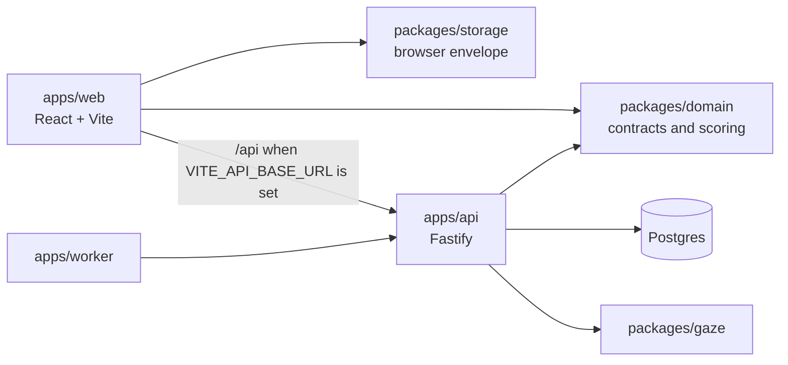

# NeuroVision

NeuroVision is a HackPrinceton 2026 research tool for spatial attention after stroke. Some people stop noticing one side of space (spatial neglect) and do not feel that anything is missing. This app runs a short browser battery, records every response in space and time, and shows where responses landed.

It describes one session. It is not a diagnosis and it is not a clinically validated instrument. Healthy-range wording uses assumed placeholders until real control data exists. See [docs/NORMS.md](docs/NORMS.md).

## What you can run today

The app shell is `apps/web/src/App.tsx`. With no API configured, the home page offers **Begin assessment**, **History**, and a **Demo run**. The nav is Home, Starry Night, Hollow rings, Line bisection, Hidden scene, and History.

| Step | What happens |
| --- | --- |
| **Starry Night** | Reaction task. Green dots blink on a dark field. Press Space or tap when a red dot flashes. The report draws each target where it appeared (caught vs missed) and hit rate by column. |
| **Hollow rings** | Cancellation board. Select hollow rings and leave solid disks on a fixed 960×540 board. Up to 60 seconds. The report shows hits, left-vs-right misses, search order, and omissions by region. |
| **Line bisection** | Mark the midpoint of five lines, one mark each, up to 15 seconds, with no accuracy feedback during the task. |
| **Review** | One combined report after the battery. Live runs save to History. The demo run is labeled demonstration and is not saved. |
| **Hidden scene** | Unscored picture task. Birds on the left stay hidden until you press Done, then the missing region fades in. It is a demo of the experience, not a scored test, and it is not stored. |
| **History** | Saved live sessions, a trend once two comparable assessments exist, and delete. With the API on, the table also shows upload and processing state, plus participant export and delete. |

Opening Starry Night, Hollow rings, or Line bisection from the nav starts at that test and continues through the rest. An interrupted trial (stop, resize, or a hidden tab) is kept as an incomplete session.

Pointer clicks are what the start path records. The board runner also has keyboard and touch modes, but the current home screen does not offer a way to select them.

## In the codebase, not on the current screens

These pieces are real code. The running UI does not open them. A few docs still describe them as product screens; trust `App.tsx` for what a visitor sees.

- **Shared-θ evidence model** (`packages/domain`, `combineEvidence`). Starry Night, hollow rings, and line bisection can be combined into a posterior over balanced / left lean / right lean. `scoreBatteryRecord` recomputes that from raw responses. The on-screen report shows the per-test maps and counts, not that posterior.
- **Clock drawing and greyscales** scorers live in `packages/domain`. Their screens were removed.
- **Practice rounds** (cue side, board density, reflection) live in `packages/domain`. Old practice routes in the UI resolve back to review or home.
- **Screening lab** (`apps/web/src/screens/Screening.tsx`, plus `src/gaze/` and `src/tests/`): webcam, mouse, synthetic, and replay gaze, a star-cancellation board, and an optional gaze heatmap. It is not mounted, so there is no Screening item in the nav. `apps/web/src/tests/README.md` still says there is.
- **Gaze lab fixtures** (`loadGazeLabData` in the web service layer, analysis in `packages/gaze`). The worker can summarize uploaded gaze traces. There is no gaze-lab page in the current shell.
- **OIDC sign-in** is implemented on the API. The demo path is local participant IDs, below.

There is no clinician dashboard. History is the session list. The report is the session review.

These ideas from the team pitch are not implemented in this tree: running the tasks under an added cognitive load, a product flow that separates noticing from reaching, a probabilistic attention map drawn for the person taking the test, and a reliability study on hackers at the event.

## Tech stack

- **Node.js 22+**, npm workspaces, TypeScript
- **Web:** React 19, Vite 6. Static build, plus a single-file build (`vite-plugin-singlefile`) that opens from disk with no API calls
- **API:** Fastify 5, cookie sessions, Zod. Postgres via `pg`. Plain Postgres is enough; Timescale hypertables are used only when that extension is installed
- **Worker:** polls leased analysis and cleanup jobs
- **Object storage:** S3 or MinIO when configured. With those variables unset, trace bytes stay in Postgres
- **Tests:** `node:test` via `tsx`
- **Deploy:** one Vercel project serves the static site and the API as a function (`vercel.json`). Details are in [docs/ARCHITECTURE.md](docs/ARCHITECTURE.md)

## Repository layout

| Path | Role |
| --- | --- |
| `apps/web` | React + Vite app: battery, report, history, and the service layer that talks to domain, storage, and the API |
| `apps/api` | Fastify API: local or OIDC identity, sessions, battery records, trace upload, exports, deletion |
| `apps/worker` | Process that leases jobs and runs trace analysis and cleanup |
| `packages/domain` | Versioned contracts, validation, scoring, norms, and the evidence model. `CONTRACTS_VERSION` is `1.2.0` |
| `packages/gaze` | Gaze samples, calibration, quality gates, replay, and trace summaries |
| `packages/storage` | Browser key-value envelope for validated sessions and battery records |
| `scripts/` | `dev`, `verify`, standalone check, Vercel API bundle |
| `api/` | Vercel function entry. The build writes the bundled server next to it |
| `docs/` | Architecture map, ownership, backend runbook, norms, demo script, merge order |
| `apps/api/fixtures/seed.sql` | Idempotent demo org and identities |

## Prerequisites

- Node.js 22 or newer (`package.json` `engines`)
- npm (the lockfile is npm; use `npm ci`)
- For the API: a Postgres database you can put in `DATABASE_URL`
- For the Docker path: Docker, plus the S3 variables noted below

## Install

From the repository root:

```bash
npm ci
```

## Run locally

### Browser only

No database and no `.env`. Sessions stay in this browser.

```bash
npm run dev -w @neurovision/web
```

Open [http://127.0.0.1:5173](http://127.0.0.1:5173). The footer reads “data stays in this browser”.

A disk copy with the same offline behavior:

```bash
npm run build:standalone
```

Open `apps/web/dist/standalone/index.html`. That build sets the API base URL empty and uses an in-memory store.

### API and web together

Copy the example env and set `DATABASE_URL` to a Postgres URL you can reach. The example string is a placeholder (`USER:PASSWORD@HOST`). `uselibpqcompat=true&sslmode=require` belongs on hosted TLS URLs; a local Postgres URL does not need it.

```bash
cp .env.example .env
# edit DATABASE_URL
npm run dev
```

`npm run dev` refuses to start until `.env` exists. It then starts the API on port **3001** and the web app on port **5173**. Vite proxies `/api` and `/health` to the API.

The checked-in example uses local identity:

| Variable | Example value | Role |
| --- | --- | --- |
| `IDENTITY_MODE` | `local` | Participant-ID sign-in. `oidc` needs the four `OIDC_*` variables and turns local sign-in off |
| `VITE_IDENTITY_MODE` | `local` | Web shows the participant-ID start step. `oidc` sends the browser to the provider |
| `VITE_API_BASE_URL` | `/` | Same-origin API. Leave it unset for the browser-only path above |
| `DEMO_SEED` | `true` | Seed `org-demo` on API startup. `false` skips that |
| `COOKIE_SECURE` | `false` | Required for `http://localhost` |
| `PORT` | `3001` | API listen port |

On first load the web app asks for a participant ID: 3–32 letters, digits, or dashes. The org stays `org-demo`. The same ID on another device loads that participant’s server history. The last ID is remembered in the browser.

With `DEMO_SEED` left on (or after `psql "$DATABASE_URL" -f apps/api/fixtures/seed.sql`):

| Subject | Role |
| --- | --- |
| `admin-demo` | Admin. Can create participants and assignments. Cannot read measurements |
| `reviewer-demo` | Reviewer. Can read the demo participant’s sessions |
| `participant-demo` | Participant |
| any other valid ID | Created as a participant on first local sign-in |

Migrations run when the API starts, and on demand:

```bash
npm run migrate
```

Without Docker, the same processes are `npm run start -w @neurovision/api` and `npm run start -w @neurovision/worker`, with `DATABASE_URL` set. More routes, cookies, and trace JSON are in [docs/BACKEND.md](docs/BACKEND.md).

### Docker Compose

`npm run dev:backend` copies `.env.example` to `.env` when `.env` is missing, then runs `docker compose up --build`. That starts Postgres 16, MinIO, the API on port 3001, and the worker. It does not start the web app. After the API is healthy, run `npm run dev -w @neurovision/web` in another terminal so the Vite proxy can reach port 3001.

Compose will not start until `S3_ACCESS_KEY_ID`, `S3_SECRET_ACCESS_KEY`, and `S3_BUCKET` are set. Those lines are commented in `.env.example`; uncomment them and set local MinIO credentials. `POSTGRES_USER`, `POSTGRES_PASSWORD`, and `POSTGRES_DB` in the example are enough for the database container. Inside Compose the API uses `postgres://…@postgres:5432/…` and `OBJECT_STORE=s3`. `IDENTITY_MODE=local` still seeds `org-demo` unless `DEMO_SEED=false`.

Do not commit `.env`.

## Tests and verify

```bash
npm test          # domain, gaze, web, storage, api, worker
npm run test:e2e  # service-layer flow in @neurovision/web
npm run build     # typecheck and production builds, including the standalone file
npm run verify    # build, both test commands, standalone-file check; rewrites docs/RELEASE_EVIDENCE.md
```

CI (`.github/workflows/ci.yml`) runs `npm ci`, `npm test`, and `npm run build` on Node 22 for pull requests and pushes.

On this tree, `npm test` reported 279 passing tests and `npm run test:e2e` reported 2. `npm run build` and `npm run verify` were not run while writing this file. `verify` overwrites [docs/RELEASE_EVIDENCE.md](docs/RELEASE_EVIDENCE.md); the copy in git was generated earlier and still lists contracts `1.2.0`.

## Architecture



Screens call `createAppServices` in `apps/web/src/services/`. That layer validates through `@neurovision/domain`, writes the browser envelope through `@neurovision/storage`, and, when `VITE_API_BASE_URL` is set, sends cookie session requests to the API (`credentials: "include"` and `x-csrf-token`). An empty base URL, or the standalone file, never calls `fetch`.

Live assessments enqueue an upload: save the session, save the batch, optional trace bytes, then finalize. The worker leases the analysis job, summarizes a gaze trace when one was uploaded, and moves processing to ready or failed. History polls that state when the API client is on.

`SessionRecord` and `BatteryRecord` are the stored contracts. Scores are recomputed from raw events. Writes go through `parseSessionRecord` and `parseBatteryRecord`.

## Docs and ownership

| Doc | What it is for |
| --- | --- |
| [docs/ARCHITECTURE.md](docs/ARCHITECTURE.md) | Contract map: board geometry, scoring, battery record, API client, Vercel, standalone build |
| [docs/OWNERSHIP.md](docs/OWNERSHIP.md) | Which workstream may edit which tree |
| [docs/BACKEND.md](docs/BACKEND.md) | API, worker, local sign-in, Compose, trace bytes |
| [docs/NORMS.md](docs/NORMS.md) | Which tests enter the model, and that the current means are placeholders |
| [docs/MERGE_ORDER.md](docs/MERGE_ORDER.md) | Order workstreams A–F were meant to land |
| [docs/DEMO_REHEARSAL.md](docs/DEMO_REHEARSAL.md) | Demonstration-session script |
| [docs/RELEASE_EVIDENCE.md](docs/RELEASE_EVIDENCE.md) | Output of `npm run verify` |

The repo was built as parallel workstreams. Agent A owns `packages/domain` and `docs/`. Agent B owns `packages/storage`, `apps/api`, and `apps/worker`. Agent C owns `packages/gaze`. Agents D and E own the product UI in `apps/web`. Agent F owns `apps/web/src/services/`, the standalone build, and `npm run verify`. The table in `docs/OWNERSHIP.md` is the rule for who edits which folder.

`docs/ARCHITECTURE.md`, `docs/DEMO_REHEARSAL.md`, and `apps/web/README.md` still describe practice screens and a gaze lab in the product UI. Those surfaces are not mounted now. Use this file and `App.tsx` for the running app, and `docs/ARCHITECTURE.md` for the domain and API contracts.
